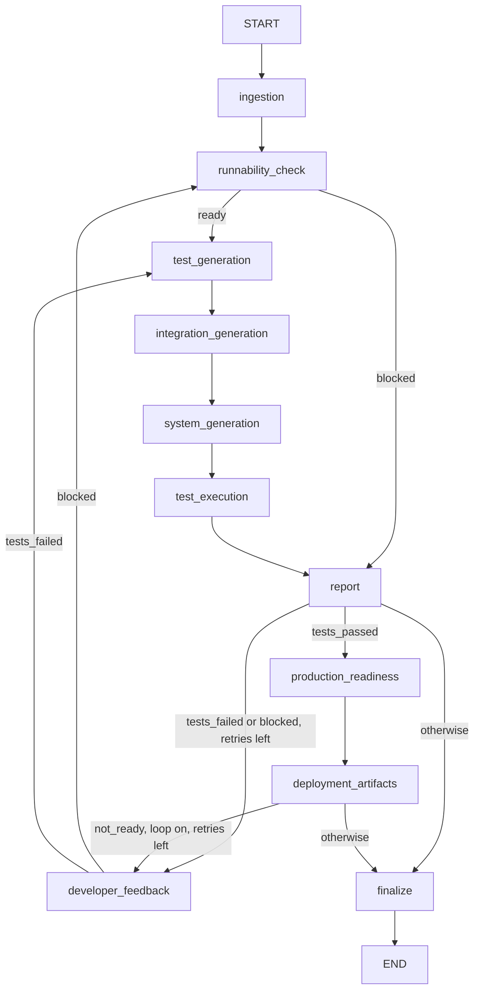

# Testing, QA and Production Agent

A LangGraph agent that tests the code a Software Developer agent produced. Give it a Django project as a zip file
(or an extracted folder). It checks that the project installs and boots, writes unit, integration and system tests from
what the project actually contains, runs them against a throwaway database, and returns a JSON report of the faults.
When the tests pass it also checks whether the project could be shipped and writes Docker files for it.

It is one part of the Software Development Multi-Agent System. The report is the input the Developer agent reads to fix
its errors. Scope: functional testing of Django projects. Load, performance and security testing need servers and are out of scope.
Nothing is ever deployed.

## Quick start

Python 3.12 is required.

```
git clone <repo url>
cd LangGraph-Test-QA-Pipeline
python -m venv venv
venv\Scripts\activate          (Linux and macOS: source venv/bin/activate)
pip install -r requirements.txt
python graph.py fixtures/runnable_example.zip
```

The first run takes a few minutes because the project's packages are installed into a fresh virtual environment.
The report is printed and also saved to `reports/<project>_report.json`.

| Command | What it does |
|---|---|
| `python graph.py project.zip` | one pass, no retries |
| `python graph.py path/to/extracted/folder` | the same, for a folder |
| `python graph.py project.zip --max-retries 3` | failing runs go back to the Developer agent up to 3 times |
| `python graph.py project.zip --demo-fix` | demo only: a mock fixer repairs the seeded bugs in the demo fixtures |
| `python graph.py project.zip --fix-production` | also send a `not_ready` production verdict back to the Developer agent |

From Python: `from testing_qa import run_testing_qa`. See `docs/integration.md`.

## How it works



1. `ingestion` unpacks the project and finds its apps, `manage.py` and requirements.
2. `runnability_check` installs the requirements in a throwaway environment and runs `manage.py check`. A project that cannot boot goes straight to the report as `blocked`.
3. `test_generation`, `integration_generation` and `system_generation` write tests from the project's real models, URLs and forms.
4. `test_execution` runs only the generated tests on in-memory SQLite, never the project's own database.
5. `report` writes the JSON report, with failures grouped by cause.
6. `production_readiness` and `deployment_artifacts` run when the tests passed.
7. `developer_feedback` sends failures back to the Developer agent (a stub today), up to a retry limit.

Details of every node, the shared state and the design decisions are in `docs/architecture.md`.

## The report

`docs/report_example.json` documents every field. The outcome is one of:

| Outcome | Meaning |
|---|---|
| `tests_passed` | every test that ran passed |
| `tests_failed` | some tests failed. `faults` lists them, each with a category, a location and a `confidence` |
| `blocked` | the project would not install or boot |
| `execution_failed` | the test run itself crashed (an environment problem, never retried) |

Skipped tests are listed in `skipped_tests` and never counted as passed. A fault with `confidence: low` came from the
generated test's own code and should be checked before the project is changed.

## Production readiness

When the tests pass, the agent checks Django's deployment settings, migrations, secrets written into the source (only the
file and line are reported, never the value), dependencies and the web-server entry point. The verdict is `ready`,
`ready_with_warnings` or `not_ready`. Files are written to `reports/<project>_deployment/`: `Dockerfile`, `.dockerignore`,
`docker-compose.yml`, `.env.example` and `DEPLOYMENT.md`. They are checked statically and never built, so review them before use.

## Fixtures and tests

| Fixture (`fixtures/`) | Expected result |
|---|---|
| `runnable_example.zip` | `tests_passed`, 17 of 17, production `not_ready` (secrets in its settings) |
| `non_runnable_example.zip` | `blocked` (a bad import) |
| `buggy_example.zip` | `tests_failed`, one fault (a model corrupts a price) |
| `buggy_flow_example.zip` | `tests_failed`, one system-test fault (a form does not save) |
| `unseen_example.zip` | `tests_passed`, 24 of 24, no false faults |
| `field_types_example.zip` | `tests_passed` (relations, dates, decimals, choices) |

```
pip install -r requirements-dev.txt
pytest -m "not slow"     fast tests, seconds
pytest                   the whole pipeline on every fixture, about 10 minutes
```

## Limits and next steps

- Django only. Test generation is deterministic (it reads the project's own models, URLs and forms). LLM-based generation for forms, views and projects without documentation is the planned next step, as are other languages.
- Unit tests check that a value survives a save. Integration tests check that a page does not crash. Flows that need a login are not system-tested.
- A project whose settings are a `settings/` package is not handled yet. The virtual environment is rebuilt on every run.
- The Developer agent is a stub. `docs/integration.md` explains how to connect the real one.

## Contributors
- Muhammad Ahmed Rayyan
- Javeria Ziad
- Huzaifa Yaqoob