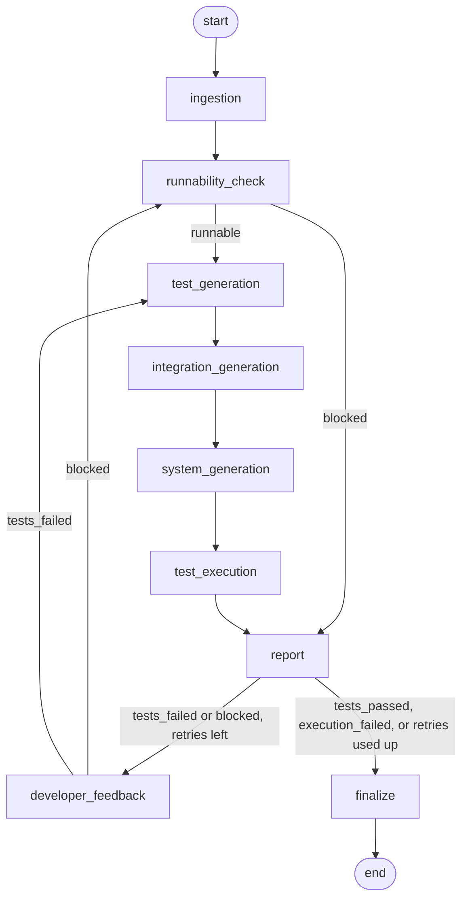

# LangGraph Test/QA Pipeline

This pipeline takes a Django project and checks whether the code does what its models, URLs and
forms declare. It installs the project's requirements into a throwaway environment, writes unit,
integration and system tests from the code, runs only those tests against an in-memory SQLite
database, and writes a JSON report for the Developer agent. When tests fail, the report goes back to the
Developer agent up to three times before a person is asked to look.

The agent works on Django projects only. Running a project's tests means running its code, so use it on
projects you trust or inside a container (see "Known limitations").

## Setup

You need Python 3.11 or newer. The team uses 3.12. From the repository root:

On Windows (PowerShell):

```powershell
py -3.12 -m venv venv
.\venv\Scripts\Activate.ps1
python -m pip install -r requirements.txt
python -m pip install -r requirements-dev.txt
```

If PowerShell refuses to run the activate script, run
`Set-ExecutionPolicy -Scope CurrentUser RemoteSigned` once and try again.

On Linux or macOS:

```bash
python3 -m venv venv
source venv/bin/activate
python -m pip install -r requirements.txt
python -m pip install -r requirements-dev.txt
```

## Run it

Pass a ZIP file or a project folder:

```powershell
python graph.py path\to\project.zip
python graph.py path\to\project_folder
```

On Linux or macOS use forward slashes. The run prints the final state as JSON, and the report is written
to `reports/<project name>_report.json`.

A ZIP is unpacked next to itself into `<name>.zip_extracted`, and that copy is the one that gets tested.
A folder is tested in place, so the generated `tests_*_generated.py` files and a `test_settings.py` are
written into it. The virtual environment is created next to the project as `_venv_<project name>`.

To see the whole loop (fail, fix, pass) without the real Developer agent, add `--demo-fix`. A mock fixer
then repairs the bugs seeded in the buggy fixtures. It is for demonstration only and does nothing for any
other project.

```powershell
python graph.py fixtures\runnable_example.zip
python graph.py fixtures\non_runnable_example.zip
python graph.py fixtures\buggy_example.zip
python graph.py fixtures\buggy_example.zip --demo-fix
```

The runnable fixture ends with status `completed`. The non-runnable one ends with `needs_human_review` and
a `blocked` report, because nothing fixes it. The buggy one also ends with `needs_human_review`, and with
`--demo-fix` it ends `completed` on attempt 2.

## How it works



The same diagram, with a description of every node, is in [docs/architecture.md](docs/architecture.md).

1. `ingestion` unpacks the project and records what it finds.
2. `runnability_check` installs the requirements and runs `manage.py check`. A project that fails either
   step is `blocked` and goes straight to the report.
3. `test_generation` writes unit tests: each model gets a valid object, and every supported field and relation
   is checked by saving and reading it back.
4. `integration_generation` sends a GET to each URL that belongs to the project's apps, anonymous and logged in.
5. `system_generation` walks flows through pages and forms: listing stored objects, creating, updating and deleting.
6. `test_execution` runs only the generated tests, with the database replaced by in-memory SQLite.
7. `report` writes the report.
8. After the report the run ends or loops back. `tests_failed` goes to `developer_feedback` and then to
   `test_generation`. `blocked` goes to `developer_feedback` and then to `runnability_check`. The limit is
   `MAX_RETRIES = 3` in `graph.py`.

The loop stops in every case. `tests_passed` ends as `completed`, `execution_failed` ends as
`environment_error`, and a failure that survives the last retry ends as `needs_human_review`.

`developer_feedback` is a stub. It writes `reports/<project name>_developer_request.json` for the real
Developer agent to read and does not change code.

## The state contract

Every node takes the state and returns `{**state, ...}`, or the state unchanged. A node must not rename
another node or change its signature. The three generators add to `test_specs` and `test_files` and never
replace what an earlier generator wrote.

| Key | Type | Written by |
|---|---|---|
| `zip_path` or `work_dir` | `str` | the caller |
| `project` | `ProjectProfile` | `ingestion` |
| `runnable` | `bool` | `runnability_check` |
| `setup_errors` | `list[SetupError]` | `runnability_check` |
| `status` | `Literal[...]` | `runnability_check`, then `finalize` |
| `test_specs` | `list[TestSpec]` | the three generators |
| `test_files` | `dict[str, str]` | the three generators |
| `test_results` | `TestResults` or `None` | `test_execution`, emptied by `developer_feedback` |
| `report_json` | `dict` | `report` |
| `retry_count` | `int` | `developer_feedback` |

The types are in `state.py`. A `TestSpec` can carry a `skipped_reason`, which records why a model or flow
got no test. The statuses are listed in `docs/architecture.md`.

## The report

`docs/report_example.json` has one example of each outcome. A report has these fields:

- `schema_version`, `outcome` and `attempt` (1 for the first run, then one more per loop).
- `project` with the name, framework, apps and whether documentation was found.
- `setup` with `runnable` and the list of setup errors.
- `execution_error`, which is `null` unless the test run crashed.
- `summary` with `total`, `passed`, `failed`, `errored` and `by_type` (unit, integration, system).
- `faults`, one entry per failing test, with `id`, `test_name`, `test_type`, `app`, `category`, `message`,
  `traceback` and `suspected_location`.

The four outcomes tell the Developer agent what kind of problem it has:

| Outcome | Meaning |
|---|---|
| `blocked` | The project could not install or boot. No tests were written. Fix `setup.errors`. |
| `execution_failed` | The test run crashed. It is not a code fault, so a person has to look. |
| `tests_failed` | Tests ran and some failed. Fix the code behind each entry in `faults`. |
| `tests_passed` | Tests ran and all passed. |

## Folder structure

```
graph.py               entry point; wires the nodes and the retry loop
state.py               AgentState and the typed dicts it uses
nodes/
  ingestion.py
  runnability_check.py
  test_generation.py         unit tests, plus the model introspection the other generators reuse
  integration_generation.py  integration tests, plus URL and view introspection
  system_generation.py       system tests
  test_execution.py
  report.py
  developer_stub.py          the Developer agent stand-in and the demo fixer
  env_utils.py               paths for the virtual environment and the settings module
docs/
  architecture.md
  report_example.json
fixtures/                    ZIP files used by the end-to-end tests
tests/
  test_pipeline.py
  sample_outputs/            saved test runner output for the parser tests
reports/                     generated, not committed
```

## Tests

Run the quick tests, which install nothing:

```powershell
pytest -m "not slow"
```

Run the full suite, which also runs the pipeline end to end on the ZIP fixtures:

```powershell
pytest
```

The full suite creates a virtual environment for each fixture and installs Django into it. It takes about
two minutes on Linux and about fifteen on a cold Windows machine.

## Add a fixture

1. Zip a small Django project. It needs a `requirements.txt` (pin Django, and add Pillow if a model has an
   `ImageField`), committed migrations, and settings that boot without secrets or an external database.
2. Save it as `fixtures/<name>_example.zip`.
3. Run `python graph.py fixtures\<name>_example.zip` and read the report. A failing generated test can be a real
   finding in the project or a mistake in the generator, so look at each one.
4. Add a test to `tests/test_pipeline.py` that calls `_run_fixture("<name>_example.zip")`, mark it
   `@pytest.mark.slow`, and assert the outcome and the counts by test type. Pass `max_retries=0` when the test
   is about a single pass and not about the loop.
5. Do not commit the `*_extracted` or `_venv_*` folders. They are in `.gitignore`.

To seed a bug, change one line and say what it is in a comment. The demo fixer only knows the two bugs
already in `buggy_example.zip` and `buggy_flow_example.zip`.

## Known limitations

- Django and Python only.
- The pipeline runs the project's code: `pip install`, `manage.py check`, URL introspection and the tests
  themselves. Do not point it at code you do not trust outside a container.
- Unit tests check that fields save and load. They do not know a model's business rules.
- Integration tests send GET requests only. They skip URLs whose view is not defined in one of the project's
  apps, URLs with regex parameters, and parameters they cannot tie to a model field.
- System tests infer flows from view source with a static reading, not by running the project. They skip
  views that filter by user, require login or read `request.user`, forms with a field type they cannot fill,
  and flows that span several steps. A page check that looks for an object's text depends on the template
  printing that field without a filter.
- Documentation files are detected and reported as `has_docs`, but nothing uses them to write tests yet.
- If no app yields any test, `test_execution` is skipped and the report says `tests_passed` with a total of 0.
  Read `summary.total` before trusting a pass.
- A `blocked` retry rebuilds the virtual environment each time, so a project that never boots makes four slow
  setup runs.
- The Developer agent is a stub. The demo fixer repairs the two seeded fixtures and nothing else.

## Phase 2 ideas

These are open and unassigned. Agree on an owner before starting any of them.

- LLM-based test generation for forms, views and projects with no documentation.
- Other languages and frameworks.
- Caching the virtual environment by a hash of `requirements.txt`.
- Using the project's documentation to decide what to test.
- The Production/DevOps module, which is waiting on the supervisor's answer.
- Connecting the real Developer agent in place of `developer_feedback`.
