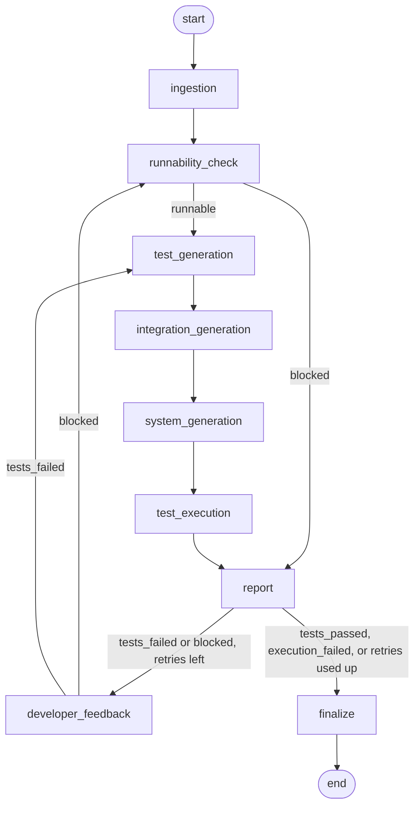

# Architecture

The pipeline takes a Django project and answers one question: does the code behave
the way its models, URLs and forms say it should? It builds the project's environment,
writes unit, integration and system tests from what the code declares, runs only those
tests against an in-memory database, and writes a JSON report. A failing report goes back
to the Developer agent, up to three times.

## The graph

The same diagram is in the README. `tests/test_pipeline.py` compares both copies with the
compiled graph, so a change to `graph.py` that is not reflected here fails a test.

## What each node does

| Node | Reads | Writes | What it does |
|---|---|---|---|
| `ingestion` | `zip_path` or `work_dir` | `work_dir`, `project` | Unzips, finds the project root, and records `manage.py`, `requirements.txt`, documentation files and the apps (every folder that holds a `models.py`). |
| `runnability_check` | `project` | `runnable`, `setup_errors`, `status` | Creates a throwaway virtual environment next to the project (`_venv_<project name>`), installs `requirements.txt`, and runs `manage.py check`. Sets `status` to `blocked` or `ready_for_test_generation`. |
| `test_generation` | `project`, `status` | `test_specs`, `test_files` | Unit tests. For each model it creates a valid object and checks that every supported field and relation reads back what was saved. A model it cannot fill is skipped and the reason goes into `skipped_reason`. |
| `integration_generation` | `project`, `status` | adds to `test_specs`, `test_files` | Integration tests. Reads the URL patterns and sends a GET to each URL that belongs to one of the project's apps, once as an anonymous visitor and once logged in. 404 and 500 fail. |
| `system_generation` | `project`, `status` | adds to `test_specs`, `test_files` | System tests. Reads each view's source, template and form, then walks full flows: a page that lists stored objects, a create flow through a form, an update flow and a delete flow. |
| `test_execution` | `project`, `test_files` | `test_results` | Writes a `test_settings.py` that replaces the project's database with in-memory SQLite, runs only the generated modules through `manage.py test`, and parses the output. |
| `report` | everything above | `report_json` | Builds the report and writes `reports/<project name>_report.json`. |
| `developer_feedback` | `report_json`, `retry_count` | `retry_count`, empties `test_specs`, `test_files`, `test_results` | Stand-in for the Developer agent. Writes `reports/<project name>_developer_request.json` and counts the retry. It never changes code. |
| `finalize` | `report_json` | `status` | Sets the final status once the run is over. |

The three generators write different file names on purpose, because `test_execution` works out
the test type from the module name:

| File | Test type |
|---|---|
| `<app>/tests_generated.py` | unit |
| `<app>/tests_integration_generated.py` | integration |
| `<app>/tests_system_generated.py` | system |

Each generator after the first adds to `test_specs` and `test_files`. None of them replaces what
an earlier one wrote.

## The loop back to the Developer agent

After `report` the run takes one of these paths.

| Report outcome | Retries left | Next | Final status |
|---|---|---|---|
| `tests_passed` | n/a | `finalize` | `completed` |
| `execution_failed` | n/a | `finalize` | `environment_error` |
| `tests_failed` | yes | `developer_feedback` | |
| `blocked` | yes | `developer_feedback` | |
| `tests_failed` or `blocked` | no | `finalize` | `needs_human_review` |

`execution_failed` means the test run itself crashed, for example because the database was
unreachable. That is an environment problem, so the Developer agent gets no request for it and a
person has to look.

The limit is `MAX_RETRIES = 3` in `graph.py`. The first run is attempt 1, so a project that is never
fixed is run four times and then ends with `needs_human_review`. Each report carries its attempt
number in the `attempt` field.

### Where the loop re-enters

The loop re-enters at the stage that failed, not at the start.

- `blocked` goes back to `runnability_check`. The problem was dependencies or a failed boot, so the
  environment has to be checked again. This rebuilds the virtual environment, which is the slow part.
- `tests_failed` goes back to `test_generation`. The code changed, so the tests are written again from
  the new code. The environment is reused.

A retry starts from empty `test_specs`, `test_files` and `test_results`. The generators append to those
lists, so stale values would duplicate specs and could send the executor to tests from the old attempt.
`developer_feedback` sets them to empty values on purpose, because LangGraph only updates the keys a node
returns.

### Demo mode

`python graph.py <project> --demo-fix` replaces `developer_feedback` with a mock fixer that undoes the bugs
seeded in `buggy_example.zip` and `buggy_flow_example.zip`. It exists to show the whole cycle (fail, fix,
pass) without the real Developer agent, and it does nothing for any other project.

## Statuses

| Status | Set by | Meaning |
|---|---|---|
| `pending` | initial | Nothing has run yet. |
| `blocked` | `runnability_check` | The project could not install or boot. |
| `ready_for_test_generation` | `runnability_check` | The project boots. The generators and the executor only act on this status. |
| `completed` | `finalize` | Every test passed. |
| `environment_error` | `finalize` | The test run crashed. A person has to look. |
| `needs_human_review` | `finalize` | Tests still failed, or the project still would not boot, after the last retry. |
