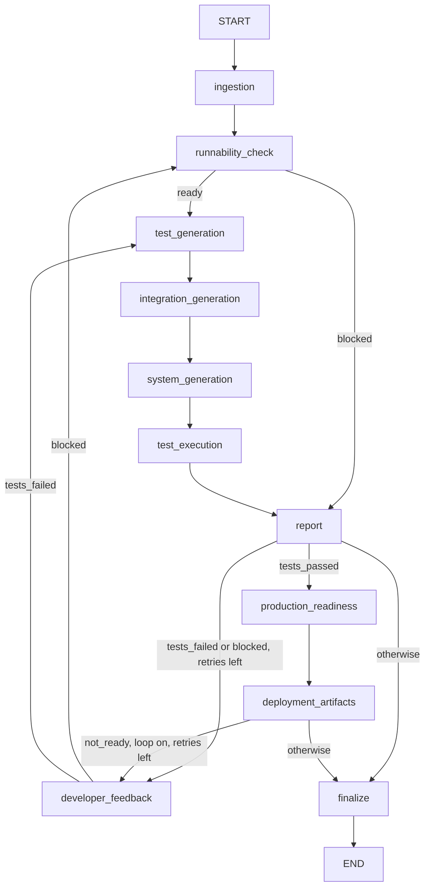

# Architecture

The Testing/QA agent takes the code a Software Developer agent produced (a zip file or an extracted
folder), tests it honestly, and returns a JSON report. The Developer agent reads that report to fix its
errors. When the tests pass, the agent also checks whether the project could be shipped. It is built as a
LangGraph state graph, so every stage is a node that reads and writes one shared state.

Scope: functional testing (unit, integration and system tests) of Django projects. Load, performance and
security testing need servers and are out of scope. The agent never deploys anything.

## The graph

The same diagram is in `README.md`. A test compares both with the graph that LangGraph compiles, so a
change to `graph.py` that is not reflected here fails the test suite.

## How one run goes

1. The project is unpacked and scanned.
2. The agent checks that the project can install its dependencies and boot. If it cannot, no tests are
   written. The run goes straight to the report with the outcome `blocked`.
3. Unit, integration and system tests are generated from what the project actually contains: its models,
   its URLs and its forms.
4. The generated tests run against an in-memory SQLite database, never the project's own database.
5. The report is written as JSON. Faults in it are what the Developer agent reads.
6. If the tests passed, the production checks run and their findings are added to the report. A set of
   deployment files is written next to it.
7. If the tests failed or the project would not boot, the run can go back to the Developer agent, up to a
   fixed number of retries, and then it stops.

## The nodes

- `ingestion`: accepts a `.zip` or an already extracted folder. Extracts a zip into a clean folder every run,
  steps into a single wrapper folder, and finds the documentation, `manage.py`, `requirements.txt` and the
  Django apps. Writes `project`.
- `runnability_check`: creates a throwaway virtual environment for the project, installs its requirements,
  and runs `manage.py check`. Each step has a time limit, and a timeout becomes a normal setup error, not a
  crash. Writes `runnable`, `setup_errors` and `status` (`ready_for_test_generation` or `blocked`).
- `test_generation`: inspects the project's models inside its own environment and writes one
  `tests_generated.py` per app (unit tests). It fills every field it knows how to fill so the object is valid,
  creates related objects first, and uses `update_or_create` for one-to-one links so a signal that already
  created the row does not cause a false failure. A model it cannot build a valid object for is skipped and
  the reason is recorded in `test_specs`.
- `integration_generation`: reads the project's URL patterns and writes `tests_integration_generated.py`.
  Each page is requested anonymously and as a logged-in user. A page that crashes (404 or 500) fails.
- `system_generation`: writes `tests_system_generated.py`. These tests follow complete flows: a page shows
  stored objects, and a form creates, updates or deletes an object. If a form rejects the generated data,
  the test is skipped, not failed, because the generator was wrong and not the project. Flows that need
  a login are skipped with the reason recorded.
- `test_execution`: writes a `test_settings.py` next to the project's settings that swaps the database for
  in-memory SQLite, then runs only the generated test modules. It tells three outcomes apart: tests ran,
  some tests were skipped, and the run itself crashed (`could_not_run`).
- `report`: decides the outcome, builds the report and writes `reports/<project>_report.json`. It runs on
  every path, including projects that never booted. Failures that share one cause are grouped into one fault.
- `production_readiness`: runs only when the tests passed. Checks whether the project could be shipped
  and adds a `production` block to the report. See below.
- `deployment_artifacts`: runs right after the production checks. Writes a `Dockerfile`, `.dockerignore`,
  `docker-compose.yml`, `.env.example` and a `DEPLOYMENT.md` checklist to `reports/<project>_deployment/`,
  built from the entry point and requirements the checks found. It never changes the project and never builds
  anything. See below.
- `developer_feedback`: stands in for the Developer agent, which another group builds. Counts the retry and
  writes `reports/<project>_developer_request.json` for it to read. It does not change any code.
- `finalize`: sets the final `status` once, after the last report.

## Shared state

Every node reads and writes one `AgentState` (`state.py`). Nothing is passed between nodes any other way.

| Key | Written by | Meaning |
|---|---|---|
| `zip_path`, `work_dir` | caller | the input, either a zip or a folder |
| `project` | `ingestion` | root folder, apps, `manage.py`, requirements, docs |
| `runnable`, `setup_errors`, `status` | `runnability_check` | whether the project boots, and why not |
| `test_specs`, `test_files` | the three generators | what was planned and the generated code |
| `test_results` | `test_execution` | per-test outcomes, counts, raw output |
| `report_json` | `report`, `production_readiness` | the report the Developer agent reads |
| `production_report` | `production_readiness` | the same production block, for convenience |
| `retry_count` | `developer_feedback` | how many times the run looped back |

A node name must never equal a state key. LangGraph rejects that.

## Outcomes and final status

The report has one of four outcomes, and the run ends with one of four statuses.

| Outcome | Meaning | Final status |
|---|---|---|
| `tests_passed` | every test that ran passed | `completed` |
| `tests_failed` | some tests failed | `needs_human_review` once retries are used up |
| `blocked` | the project would not install or boot | `needs_human_review` once retries are used up |
| `execution_failed` | the test run itself crashed, for example a database could not be reached | `environment_error` |

`execution_failed` never loops back to the Developer agent. It is an environment problem, not code the
Developer agent can fix. The number of retries is `MAX_RETRIES` (3) in `graph.py`. The command line runs
with no retries unless `--max-retries` or `--demo-fix` is given, because a stub cannot fix anything.

## The loop

When the Developer agent is connected, a `tests_failed` or `blocked` report goes back to it. The run then
re-enters where the problem was: `blocked` goes back to `runnability_check` (the environment is rebuilt),
and `tests_failed` goes back to `test_generation` (the code changed, so the tests are regenerated). A run that
never gets fixed stops after the retry limit, so the loop cannot run forever.

Production findings can use the same loop, but only when asked (`--fix-production`, or
`build_graph(loop_on_production=True)`). A `not_ready` verdict then goes back to the Developer agent, and the
run ends `needs_human_review` if it is still `not_ready` once the retries are used up. It is off by default
because a project can be correct and still not production ready (for example a secret written into its
settings), and nothing can fix that until a real Developer agent is connected.

## The report

`docs/report_example.json` documents every field and shows each outcome. In short: `outcome`, `attempt`,
`project`, `setup`, `summary` (counts, including skipped tests), `faults`, `skipped_tests`, and a
`production` block when the tests passed.

Reports are written so that a green result cannot be misread:

- A skipped test is counted in `total` but never in `passed`, and it is listed in `skipped_tests`.
- Every fault has a `confidence`. It is `low` when the error came from the generated test's own code, with no
  frame in the project's code. A low-confidence fault is kept, because it can still be real, but it tells the
  reader to check the test before changing the project.
- A table that the project's migrations never create fails many tests for one reason. They are reported as
  one `missing_migrations` fault with every affected test listed.
- Tests that crash with the same exception on the same line of the project's own code are reported as one
  fault, with every affected test listed in `affected_tests`. A fault with no frame in the project's code is
  never merged with another.
- A page that crashes shows the real exception and the project file it came from, because the generated
  tests let the exception through.

## Production readiness

This node answers "is this code ready to ship, and what is in the way?" without a server and without Docker.

| Check | What it looks for |
|---|---|
| Django deployment check | `manage.py check --deploy`: DEBUG on, a weak secret key, missing security settings |
| Migrations | `makemigrations --check`, run on in-memory SQLite |
| Settings | `ALLOWED_HOSTS` allowing every host, no `STATIC_ROOT`, a SQLite default database |
| Secrets | passwords, keys and URLs with credentials written in the source. Only the kind, file and line are reported, never the value |
| Dependencies | unpinned packages, no production web server listed |
| Entry point | a `wsgi.py` or `asgi.py` a server can start |

Findings have a severity. One `high` finding makes the verdict `not_ready`. Medium and low findings give
`ready_with_warnings`. No findings gives `ready`. By default the verdict is advice: it does not change the final
status and does not send anything back to the Developer agent (see the loop above).

## Deployment artifacts

The files are written to `reports/<project>_deployment/`, never into the project.

| File | Content |
|---|---|
| `Dockerfile` | Python 3.12, the project's requirements, a web server (`gunicorn` for WSGI, `uvicorn` for ASGI, installed if the project does not list one), the system libraries a database driver needs, a non-root user, and the start command from the entry point the checks found |
| `.dockerignore` | keeps the virtual environment, `.env`, the database file and the generated test files out of the image |
| `docker-compose.yml` | the web service, plus a Postgres service with a health check when a Postgres driver is listed |
| `.env.example` | variable names with placeholders only. Secret values from the project are never copied |
| `DEPLOYMENT.md` | the blocking and other findings as a checklist, the settings the files expect, first-deploy steps and a rollback plan |

Each artifact is checked statically: `manage.py`, the requirements file and the entry point module must exist, and every
file must have been written. The results are in `production.artifact_checks`. The files are never built or run, so review them before use. They also cannot change the project: if its settings do not read `DJANGO_SECRET_KEY`, `DJANGO_DEBUG` and `DJANGO_ALLOWED_HOSTS` from the environment, `DEPLOYMENT.md` says the settings must change.

## Design decisions

- **A throwaway environment per project.** The target project's own Django version and packages are used, so
  introspection and tests match the real project, and one broken project cannot affect the next.
- **Tests never touch the project's database.** A project can point at a hosted database. Running tests
  against it would try to create and drop a database on someone else's server.
- **Deterministic generation first.** The generators read the project's real models, URLs and forms. That
  gives a baseline that can be reproduced and checked, to compare any later LLM-based generator against.
- **A generated test that cannot justify itself is skipped, not guessed.** Each skip records its reason.
- **Honest reporting over a clean report.** Failures from the generator's own mistakes are labelled, never
  hidden, and never passed on as certain faults in the project.

## Known limits

- Django only. Other frameworks and languages are not handled.
- Unit tests check that a value survives a save and a reload, so they catch few logic bugs.
- Integration tests check that a page does not crash. They do not check its content.
- Flows that need a login are not system-tested.
- A project whose settings are a package (`settings/`) instead of one `settings.py` is not handled.
- The virtual environment is rebuilt on every run, which takes minutes.
- The Developer agent is a stub, so the production loop (`--fix-production`) cannot fix anything yet.
- The deployment files are generated from the project's files and checked statically. They are never built.

## Files

| Path | Purpose |
|---|---|
| `graph.py` | the graph, routing, retry limit and the command line |
| `state.py` | the shared state and result types |
| `nodes/` | one file per node, plus `env_utils.py` for virtual-environment paths |
| `docs/report_example.json` | the report contract with one example per outcome |
| `fixtures/` | zipped test projects: clean, broken, buggy, unseen and others |
| `tests/` | fast tests, and slow tests that run the whole pipeline on the fixtures |
| `reports/` | reports written by runs (not committed) |